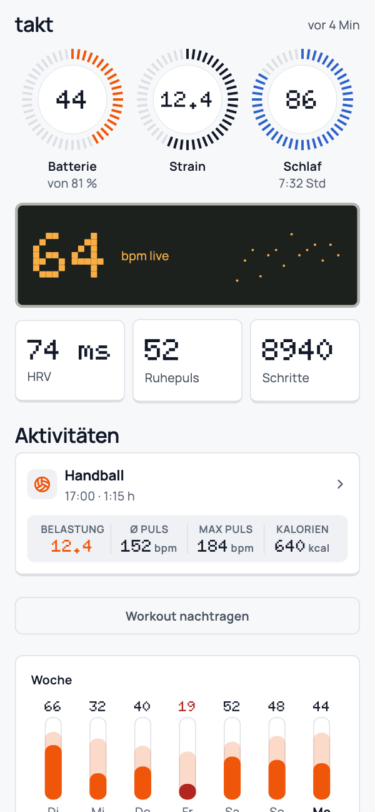
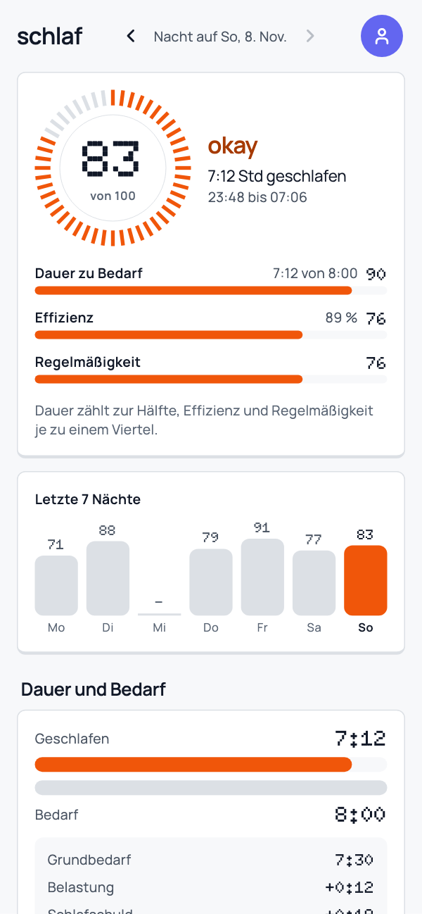
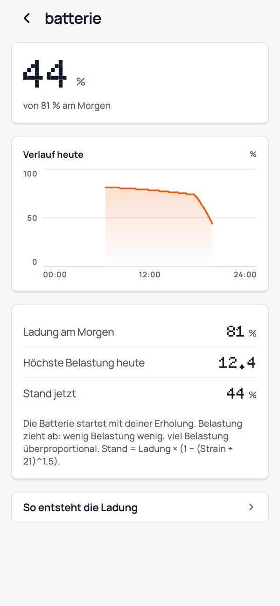
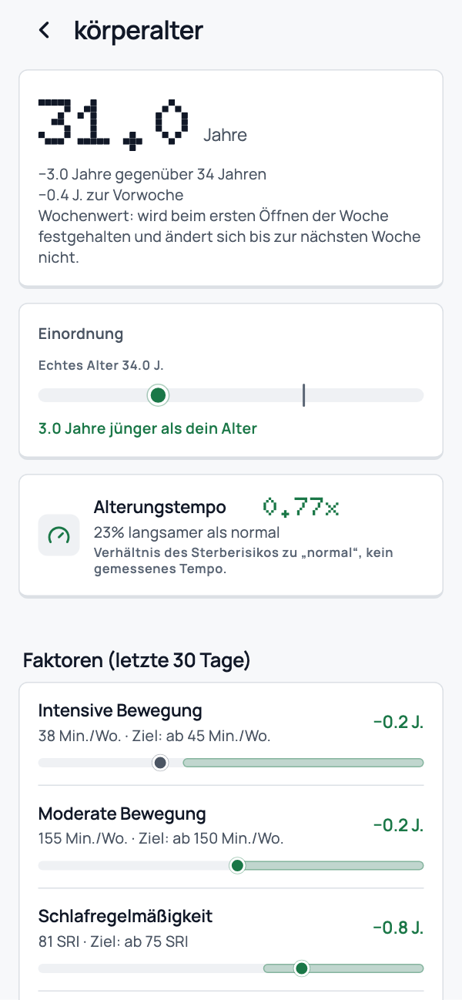
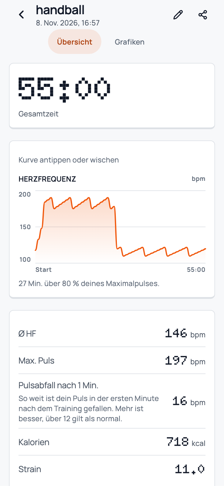
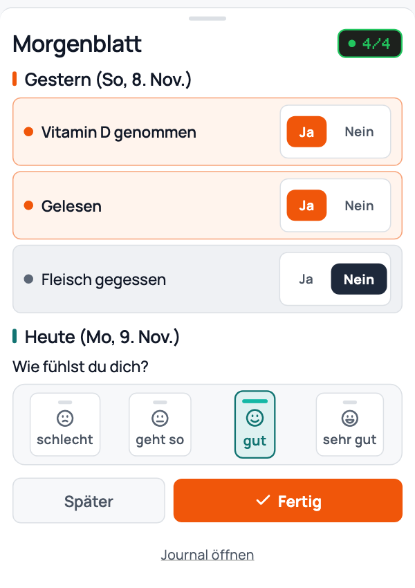

<div align="center">

# takt

**Deine WHOOP-Daten auf deinem Handy — direkt, lokal und im taktilen Pult-Design.**

Öffnen und sofort Ringe, Live-Puls auf dem Punktmatrix-Display, Tagesbatterie, Schlafscore, Körperalter und Trainings sehen. Kein Abo, keine Cloud, kein Tracking.

[](https://github.com/FelixKramp/takt/releases)
[](LICENSE)
[](#selbst-bauen)

</div>

<br>

|  |  |  |  |  |  |
|:--:|:--:|:--:|:--:|:--:|:--:|
| **Heute** | **Schlaf** | **Batterie** | **Körperalter** | **Training** | **Journal** |

---

## Was Takt macht

Takt liest dein WHOOP-Band direkt per Bluetooth Low Energy (BLE) aus, speichert alle Rohdaten lokal auf deinem Smartphone und berechnet daraus sämtliche Metriken direkt auf dem Gerät:

- **Heute im Pult-Design** — Batterie, Belastung (Strain) und Schlaf als Drehregler-Ringe, dazu Live-Puls als Bernstein-Punktmatrix-Anzeige (`Doto`), Tagespuls- & Tagesstress-Kurve und sofortiger Tageswechsel.
- **Körperbatterie über den Tag** — Startet mit deiner morgendlichen Erholung und fällt überproportional zur Tagesbelastung (`Stand = Ladung × (1 − (Strain ÷ 21)^1,5)`), inklusive 7-Tage-Übersicht.
- **Schlafscore & 7-Nächte-Balken** — Transparent zusammengesetzt aus Dauer zu Bedarf (50 %), Effizienz (25 %) und Regelmäßigkeit (25 %).
- **Gesundheit & Körperalter** — Vitalwerte, Trends und geschätztes Körperalter aus 7 Lebensstil-Faktoren der letzten 30 Tage (Schlaf, Regelmäßigkeit, Ruhepuls, Schritte, moderate/intensive Bewegung, Krafttraining). Pro Faktor zeigt ein Dropdown, wie die letzten 7 Tage im Vergleich zu den 30 Tagen aussehen.
- **Trainings & Handball-Support** — Automatisch erkannte Aktivitäten landen ohne Extra-Bestätigung in der Liste, mit ablesbarem Pulsverlauf, Zonenminuten, Pulsabfall nach 1 Minute und Sportarten-Katalog inklusive Handball.
- **Morgenblatt & Journal** — Unter einer Minute am Morgen: Gewohnheiten von gestern (Ja/Nein, eigene Fragen möglich) und wie du dich heute fühlst. Die Auswertung *Was tut mir gut* vergleicht Tage mit und ohne Gewohnheit anhand der Batterie am Morgen danach (*Hilft / Kostet*) und rechnet Zufallstreffer heraus. Zahlen erscheinen erst ab 5 Ja- und 5 Nein-Tagen. Private Fragen verlassen das Gerät nie.
- **White Mode & Dark Mode** — Helle Aluminium/Weiß-Oberfläche bei Tag, eloxiertes Dunkel bei Nacht.

---

## Geräte & Datenschutz

- **Plattform:** Android. Eine iPhone-Version gibt es noch nicht.
- **Unterstützte Bänder:** WHOOP 4.0, 5.0 und MG *(Hinweis: die offizielle App sollte zuvor vollständig beendet werden, da Bluetooth jeweils nur eine aktive Verbindung zulässt)*.
- **100 % lokal:** Alle Sensordaten, Auswertungen und Journal-Einträge bleiben auf deinem Gerät.
- **Keine Telemetrie:** Firebase Analytics, Crashlytics und automatische Fehler-/Ticket-Uploads an fremde Server sind in Takt deaktiviert bzw. entfernt.

Mehr Details stehen in [PRIVACY.md](PRIVACY.md) und [SECURITY.md](SECURITY.md).

---

## Herkunft & Hinweis

Takt ist ein Fork von [OpenStrap](https://github.com/OpenStrap) und nutzt dessen Bluetooth-Protokoll und Signalverarbeitung als Basis. Takt ist **kein** offizielles OpenStrap-Projekt und steht in keiner Verbindung zu OpenStrap, WHOOP oder anderen Geräteherstellern. Genannte Produkt- und Markennamen gehören ihren jeweiligen Inhabern und dienen ausschließlich der Beschreibung der Kompatibilität.

> **Kein Medizinprodukt:** Alle Werte, Schätzungen (insbesondere Körperalter, Alterungstempo und Stress) und Journal-Auswertungen dienen ausschließlich der persönlichen Orientierung und ersetzen keine medizinische Beratung oder Diagnose.

---

## Selbst bauen

Voraussetzungen: **Flutter 3.41.6**, **JDK 17** und **Android SDK**.

```bash
cp .env.example .env
flutter pub get
flutter run --dart-define-from-file=.env
```

Tests und statische Analyse ausführen:

```bash
flutter analyze lib test
flutter test test/takt
```

Feature-Spezifikationen und Architekturentscheidungen liegen unter [`docs/features/`](docs/features/). Weitere Hinweise stehen in [NOTICE.md](NOTICE.md) und [TRADEMARKS.md](TRADEMARKS.md).

---

## Lizenz

Veröffentlicht unter der **AGPL-3.0** — siehe [`LICENSE`](LICENSE). Der vollständige Quellcode steht in diesem Repository.
